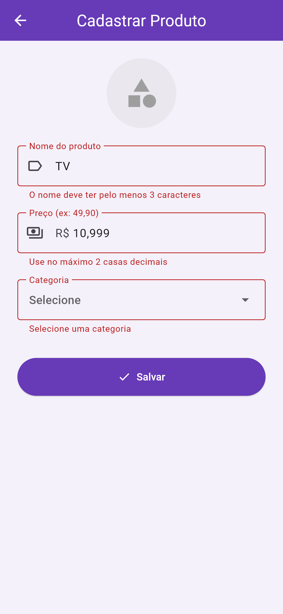

# Catálogo de Produtos

Atividade feita em Flutter.

O app mostra uma lista de produtos usando `ListView.builder`. Cada produto aparece em um Card com o ícone da categoria, nome, preço e o botão Comprar. Tocando no produto ou em Comprar aparece um SnackBar avisando que foi adicionado ao carrinho.

O botão "Novo produto" abre a tela Cadastrar Produto, onde informa o nome, o preço e a categoria (DropdownButton). Ao salvar, o produto vai pro final da lista e o ícone do card vem da categoria escolhida.

## Validação do formulário

O cadastro usa o widget `Form` com uma `GlobalKey<FormState>`. Ao tocar em Salvar, o `validate()` confere as regras de cada campo e, se alguma falhar, mostra a mensagem embaixo do campo e não sai da tela.

| Campo | Regras |
|---|---|
| Nome | obrigatório, mínimo 3 e máximo 40 caracteres, precisa ter letras |
| Preço | obrigatório, só números (aceita vírgula ou ponto), até 2 casas decimais, maior que zero, até R$ 100.000,00 |
| Categoria | obrigatória (o `DropdownButton` fica dentro de um `FormField`) |

## Prints

   

## Como rodar

```
flutter pub get
flutter run
```
