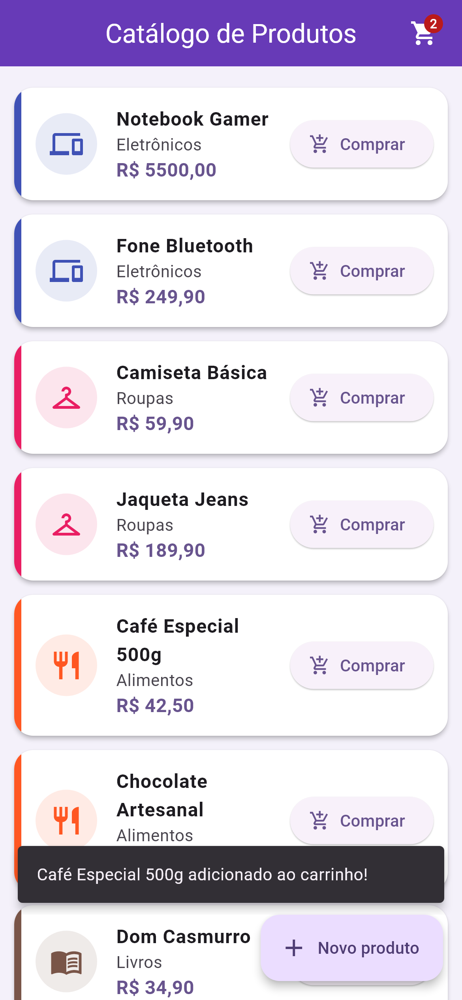
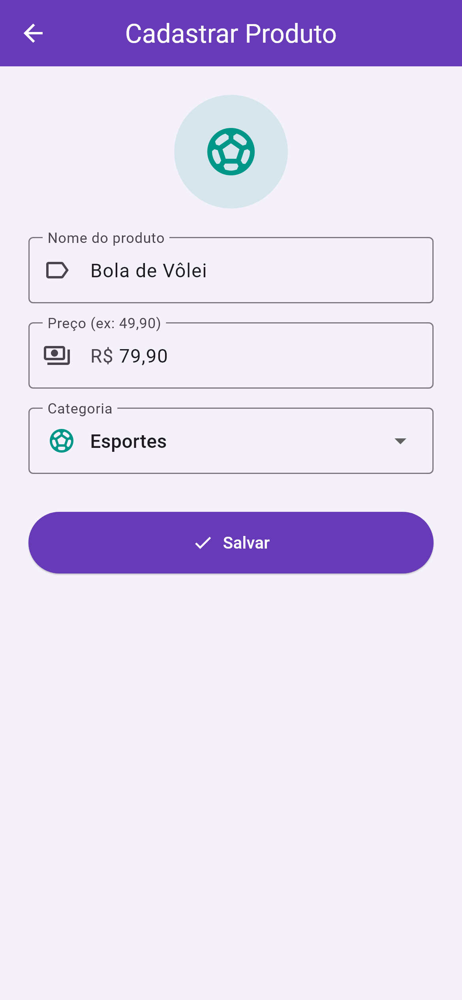
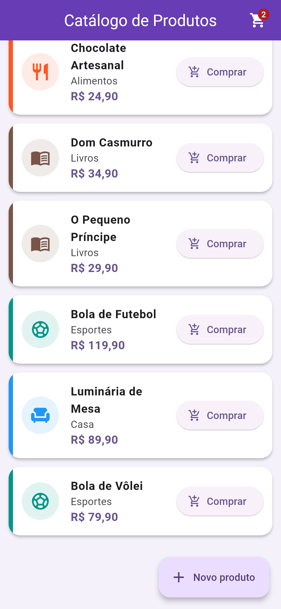

# Catálogo de Produtos

Atividade 5 (Lista) feita em Flutter.

O app mostra uma lista de produtos usando `ListView.builder`. Cada produto aparece em um Card com o ícone da categoria, nome, preço e o botão Comprar. Tocando no produto ou em Comprar aparece um SnackBar avisando que foi adicionado ao carrinho.

O botão "Novo produto" abre a tela de cadastro, onde informa o nome, o preço e a categoria (DropdownButton). Ao salvar, o produto vai pro final da lista.

## Prints

  

## Como rodar

```
flutter pub get
flutter run
```
